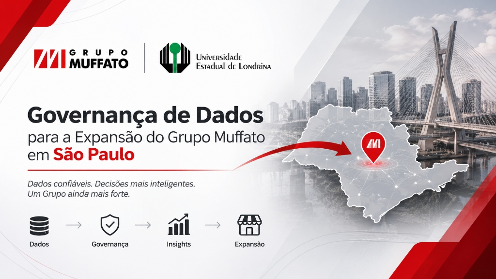
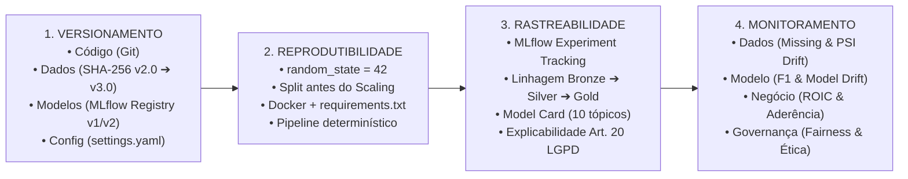
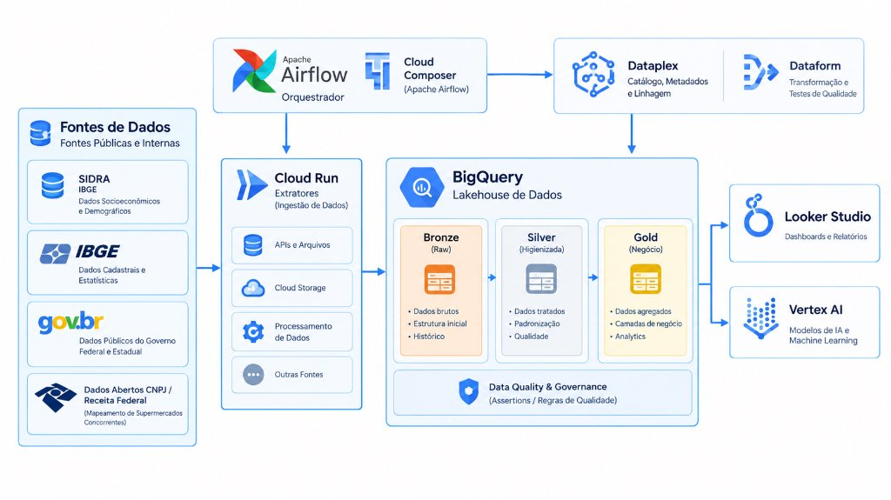
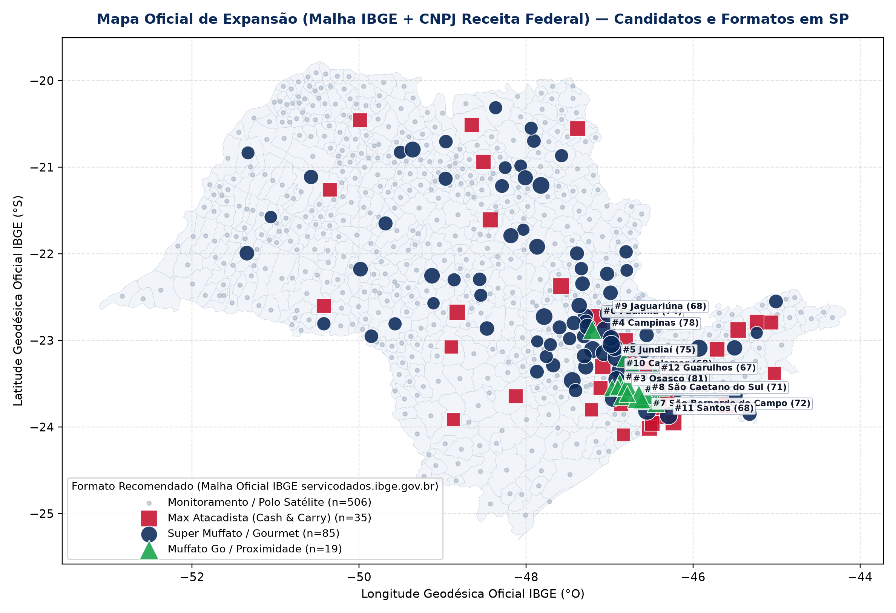
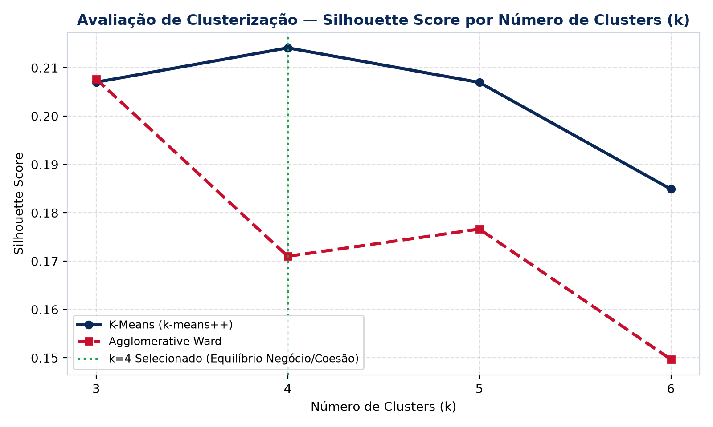
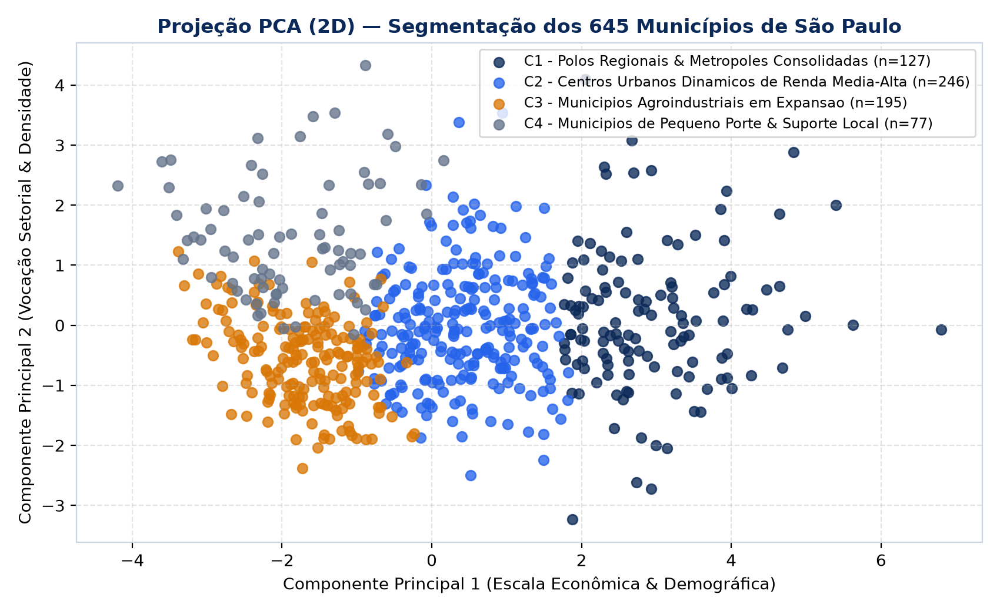
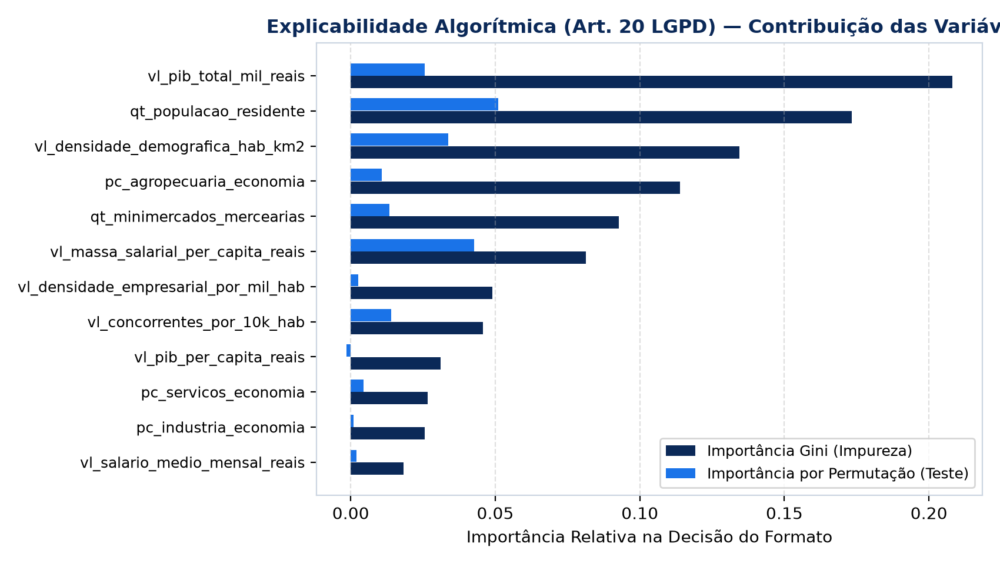
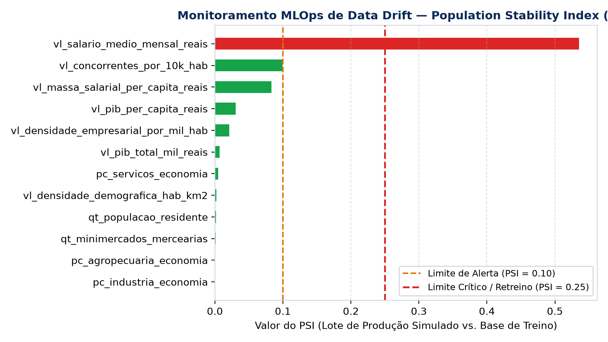

<div align="center">



# Governança de TI, de Dados e de IA Aplicada à Expansão Varejista
### Estudo de Caso Acadêmico: Inteligência Macro-Locacional para o Grupo Muffato nos 645 Municípios de São Paulo

[](https://www.uel.br/)
[](#)
[](#)
[](#)
[](#)
[](#)

</div>

---

## 🎓 Sobre Este Projeto Acadêmico

Este repositório apresenta a implementação prática das **Etapas 3 e 4 (Desenvolvimento, Rastreabilidade da Solução e Governança de IA / MLOps)** do **Projeto Integrador** da disciplina de **Governança de TI e de Dados**, ministrada pelo **Prof. Dr. André Menolli** no 6º semestre do curso de **Bacharelado em Ciência de Dados e Inteligência Artificial** da **Universidade Estadual de Londrina (UEL)**.

* **Equipe Responsável:** Guilherme Terziotti, Lucas Silva e Marcos Beregula
* **Natureza do Trabalho:** Estudo de caso acadêmico e independente, desenvolvido integralmente a partir de **dados públicos oficiais** do **IBGE** (Censo Demográfico 2022, PIB Municipal, CEMPRE e API Oficial de Malhas Geográficas) e da **Receita Federal do Brasil (`gov.br` — Dados Abertos de CNPJ)**.
* **Premissa Central da Disciplina:**
  > *O foco não é "Quem consegue maior acurácia?", mas sim: **"É possível compreender, reproduzir e governar como esse modelo foi produzido e garantir que ele continue funcionando adequadamente em produção?"***

---

## 🧭 Os 4 Pilares de Governança & MLOps (Versionamento, Reprodutibilidade, Rastreabilidade e Monitoramento)



| Pilar de Foco | Como Está Demonstrado no Projeto | Artefatos de Comprovação |
| :--- | :--- | :--- |
| **1. Versionamento** | Controle explícito de versão nas 4 dimensões: **Código** (Git), **Dados** (transição rastreada via hash SHA-256 de `v2.0-ibge-2022-silver` com 32 colunas para `v3.0-ibge-cnpj-concorrentes` com 44 colunas), **Modelo** (*MLflow Model Registry* `Version 1` ➔ `Version 2`) e **Configurações** (`YAML`). | • [`config/settings.yaml`](config/settings.yaml)<br/>• [`data/muffato_expansao_sp_governado_v2_ibge.csv`](data/muffato_expansao_sp_governado_v2_ibge.csv)<br/>• [`reports/municipios_sp_governado_v3_concorrentes.csv`](reports/municipios_sp_governado_v3_concorrentes.csv) |
| **2. Reprodutibilidade** | Semente determinística global (`random_state=42`), ambiente containerizado via Docker (`Dockerfile` + `docker-compose.yml`) e prevenção estrita de *Data Leakage* (`train_test_split` estratificado executado **antes** do `fit` do `RobustScaler` dentro de `sklearn.pipeline.Pipeline`). | • [`Dockerfile`](Dockerfile) & [`docker-compose.yml`](docker-compose.yml)<br/>• [`requirements.txt`](requirements.txt)<br/>• [`pipeline/02_etapa3_modelagem_iav.py`](pipeline/02_etapa3_modelagem_iav.py) |
| **3. Rastreabilidade** | Registro completo do fluxo `Experimento ➔ Parâmetros ➔ Métricas ➔ Modelo ➔ Artefatos` no **MLflow** e no **BigQuery**, além de Dicionário de Dados, Matriz de Linhagem e **Model Card** completo. | • [`governanca/model_card.md`](governanca/model_card.md)<br/>• [`governanca/dicionario_dados.md`](governanca/dicionario_dados.md)<br/>• [`governanca/registro_transformacoes.md`](governanca/registro_transformacoes.md) |
| **4. Monitoramento** | Simulação de novo lote de dados em produção avaliando as 4 dimensões obrigatórias (**Dados, Modelo, Negócio e Governança**) com cálculo de **PSI (*Population Stability Index*)**, teste **Kolmogorov-Smirnov (KS)** e auditoria de explicabilidade (**Art. 20 da LGPD**). | • [`pipeline/03_etapa4_mlops_monitoramento.py`](pipeline/03_etapa4_mlops_monitoramento.py)<br/>• [`governanca/plano_monitoramento.md`](governanca/plano_monitoramento.md)<br/>• [`reports/mlops_monitoring_drift.csv`](reports/mlops_monitoring_drift.csv)<br/>• [`reports/mlops_explainability_lgpd.csv`](reports/mlops_explainability_lgpd.csv) |

---

## 🏛️ Frameworks de Governança Contemplados no Projeto

| Esfera de Governança | Frameworks & Normas Aplicadas | Aplicação Prática no Estudo de Caso (Grupo Muffato — SP) |
| :--- | :--- | :--- |
| **1. Governança Corporativa** | • **Código IBGC (6ª Edição)**<br/>• **Princípios G20/OCDE** | Aplicação de **Transparência, Equidade, Prestação de Contas (*Accountability*) e Responsabilidade Corporativa** para embasar decisões de investimento (*CAPEX* de R\$ 5M a R\$ 60M por loja) perante o Conselho de Administração e o Comitê de Expansão. |
| **2. Alinhamento Estratégico & Direitos Decisórios** | • **SAM (*Henderson & Venkatraman*)**<br/>• **Matriz de Weill & Ross (MIT CISR)** | Conecta a estratégia de expansão multiformato (*Max Atacadista*, *Super Muffato* e *Muffato Go*) à arquitetura de TI e Dados, delimitando responsabilidades entre *Data Owners*, *Data Stewards* e *Data Custodians*. |
| **3. Governança e Gestão de TI Corporativa** | • **COBIT 2019 (ISACA)**<br/>• **ISO/IEC 38500:2024** | Operacionalização dos objetivos de governança (`EDM01`, `EDM02`, `EDM03` — avaliação de valor e otimização de risco) e de gestão (`APO12` Riscos, `APO14` Gestão de Dados, `BAI03` Construção de Soluções e `MEA01` Monitoramento). |
| **4. Governança e Qualidade de Dados** | • **DAMA-DMBOK (2ª Edição)**<br/>• **ISO/IEC 25012** | Arquitetura Medalhão (*Bronze ➔ Silver ➔ Gold*) no Google BigQuery, Catálogo de Metadados (44 atributos), Linhagem (*Data Lineage*) e testes automatizados (*Assertions*) nas 6 dimensões de qualidade (*100% de completude e unicidade nos 645 municípios*). |
| **5. Governança de IA, Ética & Privacidade** | • **LGPD (Lei nº 13.709/2018 — Art. 20)**<br/>• **ISO/IEC 42001 / NIST AI RMF**<br/>• **IA Responsável (*Fairness & XAI*)** | Uso 100% restrito a estatísticas públicas agregadas por município (*Privacy by Design*), auditoria de importância de variáveis em conformidade com o **Artigo 20 da LGPD**, mitigação de viés territorial via **Massa Salarial Formal** e decisão final *Human-in-the-Loop*. |

---

## 🏗️ Arquitetura Planejada e Integração de Dados Públicos

O diagrama abaixo apresenta a arquitetura de referência planejada pela equipe para integrar as fontes públicas oficiais (**IBGE / SIDRA**, **gov.br** e **Dados Abertos de CNPJ da Receita Federal**) à plataforma Lakehouse no **Google BigQuery (`projeto-governanca`)**, servindo o **Looker Studio** e a esteira de **Machine Learning / MLOps**:

<div align="center">



</div>

### Fontes Públicas Oficiais Integradas (`Bronze ➔ Silver v3.0`)
1. **IBGE (Censo Demográfico 2022, Contas Regionais / PIB Municipal e CEMPRE):** População residente, área territorial, densidade demográfica, PIB total e *per capita*, Valor Adicionado Bruto setorial (*Serviços, Indústria, Agropecuária*) e estatísticas formais de emprego e **Massa Salarial Anual**.
2. **Dados Abertos de CNPJ da Receita Federal (`gov.br`):** Mapeamento completo dos estabelecimentos varejistas ativos (`situacao_cadastral = Ativa`) nos 645 municípios de São Paulo ([`reports/cnpj_concorrentes_sp_raw.csv`](reports/cnpj_concorrentes_sp_raw.csv)):
   * **1.570 Hipermercados** (CNAE `4711-3/01`);
   * **11.062 Supermercados** (CNAE `4711-3/02`);
   * **7.917 Atacadistas de Alimentos / Atacarejos** (CNAEs `4691-5/00`, `4639-7/01`, `4639-7/02`);
   * **82.606 Minimercados, Mercearias e Armazéns** (CNAE `4712-1/00` — demanda B2B para o formato *Max Atacadista*).
3. **API Oficial de Malhas Geográficas do IBGE (`servicodados.ibge.gov.br`):** Extração dos **645 polígonos municipais oficiais** ([`reports/ibge_malha_municipios_sp.geojson`](reports/ibge_malha_municipios_sp.geojson)) e dos centroides geodésicos oficiais ([`reports/ibge_diretorio_geoespacial_sp_raw.csv`](reports/ibge_diretorio_geoespacial_sp_raw.csv)).

---

## 🤖 Síntese da Modelagem Analítica (Detalhes em `governanca/`)

O pipeline analítico ([`pipeline/02_etapa3_modelagem_iav.py`](pipeline/02_etapa3_modelagem_iav.py)) opera em **3 frentes encadeadas** — cuja formulação matemática, hiperparâmetros e justificativa de métricas de negócio estão detalhados em **[`governanca/arquitetura_modelos_e_metricas.md`](governanca/arquitetura_modelos_e_metricas.md)** e no **[`governanca/model_card.md`](governanca/model_card.md)**:
1. **Aprendizado Não Supervisionado (Clusterização de Praças):** Comparação entre **K-Means (`k-means++`)** e **Agglomerative Clustering (`Ward`)** com projeção **PCA 2D** ($k=4$ perfis municipais avaliados por `Silhouette`, `Davies-Bouldin` e `Calinski-Harabasz`);
2. **Modelo Multicritério de Scoring (`IAV` $\in [0, 100]$):** Ranqueamento dos 645 municípios ponderando Demografia (30%), Poder de Compra / Massa Salarial (30%), Dinamismo Econômico (25%) e Oportunidade Concorrencial CNPJ (15%);
3. **Aprendizado Supervisionado (Recomendador de Formatos de Loja):** Comparação empírica entre 6 algoritmos (`DummyClassifier`, `Logistic Regression`, `Decision Tree`, `Random Forest n=100`, `Random Forest n=200` e `Gradient Boosting`), avaliados por `Accuracy`, `F1-Macro`, `Precision`, `Recall` e `ROC-AUC OvR`.

---

## 🤖 Síntese da Modelagem Analítica (Detalhes em `governanca/`)

O pipeline analítico ([`pipeline/02_etapa3_modelagem_iav.py`](pipeline/02_etapa3_modelagem_iav.py)) opera em **3 frentes encadeadas** — cuja formulação matemática, hiperparâmetros e justificativa de métricas de negócio estão detalhados em **[`governanca/arquitetura_modelos_e_metricas.md`](governanca/arquitetura_modelos_e_metricas.md)** e no **[`governanca/model_card.md`](governanca/model_card.md)**:
1. **Aprendizado Não Supervisionado (Clusterização de Praças):** Comparação entre **K-Means (`k-means++`)** e **Agglomerative Clustering (`Ward`)** com projeção **PCA 2D** ($k=4$ perfis municipais avaliados por `Silhouette`, `Davies-Bouldin` e `Calinski-Harabasz`);
2. **Modelo Multicritério de Scoring (`IAV` $\in [0, 100]$):** Ranqueamento dos 645 municípios ponderando Demografia (30%), Poder de Compra / Massa Salarial (30%), Dinamismo Econômico (25%) e Oportunidade Concorrencial CNPJ (15%);
3. **Aprendizado Supervisionado (Recomendador de Formatos de Loja):** Comparação empírica entre 6 algoritmos (`DummyClassifier`, `Logistic Regression`, `Decision Tree`, `Random Forest n=100`, `Random Forest n=200` e `Gradient Boosting`), avaliados por `Accuracy`, `F1-Macro`, `Precision`, `Recall` e `ROC-AUC OvR`.

---

## 📈 Resultados Visuais e Diagnósticos de MLOps

### 1. Mapa Oficial de Expansão e Formatos Recomendados em SP (139 Praças Candidatas)
<div align="center">



</div>

### 2. Clusterização ($k=4$), Matriz de Confusão, Explicabilidade (LGPD Art. 20) e Drift (PSI)

| Curva Silhouette (K-Means vs. Ward) | Projeção PCA 2D dos 645 Municípios |
| :---: | :---: |
|  |  |

| Explicabilidade Algorítmica (Art. 20 LGPD) | Monitoramento Contínuo de Data Drift (PSI) |
| :---: | :---: |
|  |  |

---

## 🗂️ Os 7 Artefatos do Pacote de Governança da Solução de IA

1. **Repositório da Solução:** Código modular em [`pipeline/`](pipeline/), [`Dockerfile`](Dockerfile), [`docker-compose.yml`](docker-compose.yml) e [`requirements.txt`](requirements.txt).
2. **Dataset Documentado:** [`governanca/dicionario_dados.md`](governanca/dicionario_dados.md), [`governanca/registro_transformacoes.md`](governanca/registro_transformacoes.md) e base governada [`reports/municipios_sp_governado_v3_concorrentes.csv`](reports/municipios_sp_governado_v3_concorrentes.csv).
3. **Registro dos Experimentos:** [`reports/mlops_experiments_log.csv`](reports/mlops_experiments_log.csv) (comparando `v2.0` vs. `v3.0`) e banco de tracking do MLflow em [`mlflow_tracking/`](mlflow_tracking/).
4. **Model Card Oficial:** [`governanca/model_card.md`](governanca/model_card.md) cobrindo os 10 tópicos exigidos.
5. **Plano de Monitoramento:** [`governanca/plano_monitoramento.md`](governanca/plano_monitoramento.md) e resultados de PSI/KS em [`reports/mlops_monitoring_drift.csv`](reports/mlops_monitoring_drift.csv).
6. **Matriz de Riscos Integrada:** [`governanca/matriz_riscos.md`](governanca/matriz_riscos.md) (Riscos de Dados, Modelo, Privacidade, Segurança e Ética).
7. **Relatório Executivo & Guia de BI:** [`governanca/relatorio_executivo.md`](governanca/relatorio_executivo.md) e [`governanca/guia_looker_studio.md`](governanca/guia_looker_studio.md).

---

## 🚀 Como Reproduzir Localmente e via Docker

### 1. Iniciar a Interface do MLflow via Docker (`http://localhost:5050`)
```bash
docker compose up -d
# Acesse http://localhost:5050 no navegador para inspecionar os Experimentos (v2.0 e v3.0) e o Model Registry
```

### 2. Executar os Pipelines em Python
```bash
python3 -m venv .venv
source .venv/bin/activate
pip install -r requirements.txt

# 1. Ingerir concorrentes CNPJ Receita Federal e consolidar camada Silver v3.0
python pipeline/01b_ingestao_concorrentes_cnpj.py

# 2. Executar pipeline da Etapa 3 (Clusterização, Scoring IAV v3.0 e Classificador Random Forest)
python pipeline/02_etapa3_modelagem_iav.py

# 3. Executar pipeline da Etapa 4 (Explicabilidade Art. 20 LGPD e Simulação de Data Drift PSI/KS)
python pipeline/03_etapa4_mlops_monitoramento.py

# 4. Registrar runs, parâmetros, métricas, gráficos e Model Card no MLflow
python pipeline/04_mlflow_tracking_local.py

# 5. Enriquecer com malha geoespacial oficial do IBGE e atualizar Views do Looker Studio
python pipeline/05_enriquecimento_geoespacial_mapa.py
```

---

<div align="center">
  <sub>Projeto Acadêmico desenvolvido na <b>Universidade Estadual de Londrina (UEL)</b> · Bacharelado em Ciência de Dados e Inteligência Artificial.<br/>Orientação: Prof. Dr. André Menolli · Equipe: Guilherme Terziotti, Lucas Silva e Marcos Beregula.</sub>
</div>
