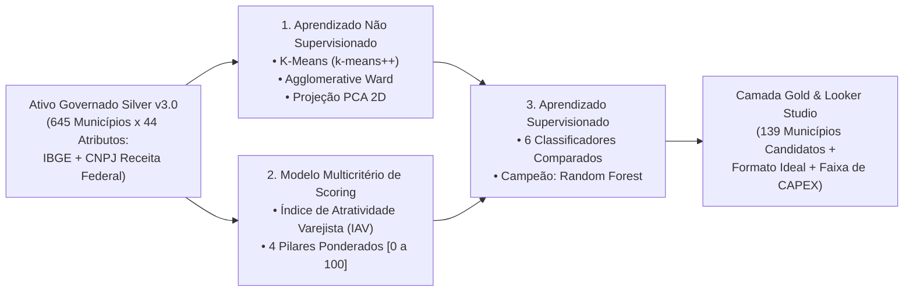

# 🤖 Arquitetura Analítica, Modelos Utilizados e Justificativa de Métricas
**Projeto Acadêmico:** Governança de TI, de Dados e de IA Aplicada à Expansão do Grupo Muffato em SP (645 Municípios)  
**Disciplina:** Governança de TI e de Dados — UEL (6º Semestre) | **Docente:** Prof. Dr. André Menolli  
**Equipe:** Guilherme Terziotti, Lucas Silva e Marcos Beregula  

---

## 1. Visão Geral das 3 Frentes Analíticas do Pipeline

O pipeline implementado em [`pipeline/02_etapa3_modelagem_iav.py`](../pipeline/02_etapa3_modelagem_iav.py) combina **três abordagens complementares** para responder às perguntas estratégicas do Comitê de Expansão:

---

## 2. Frente 1 — Aprendizado Não Supervisionado (Clusterização de Praças)

* **Pergunta de Negócio:** *Quais municípios paulistas possuem estrutura socioeconômica, vocação produtiva e densidade concorrencial semelhantes?*
* **Pré-processamento Governado:** Transformação monotônica $\log_{10}$ sobre variáveis assimétricas de cauda longa (`qt_populacao_residente`, `vl_pib_total_mil_reais`, `vl_densidade_demografica_hab_km2`, `vl_pib_per_capita_reais`, `vl_massa_salarial_per_capita_reais`, `qt_minimercados_mercearias`), seguida de padronização por mediana e intervalo interquartil (`RobustScaler` winsorizado em $[-3.5, 3.5]$).
* **Algoritmos Testados ($k \in \{3, 4, 5, 6\}$):**
  1. **K-Means (`init='k-means++'`, `n_init=50`, `random_state=42`)** — *Modelo selecionado* e serializado em [`models/kmeans_municipios_sp.joblib`](../models/kmeans_municipios_sp.joblib);
  2. **Agglomerative Hierarchical Clustering (`linkage='ward'`)** — Benchmark hierárquico para validação de estabilidade;
  3. **PCA (*Principal Component Analysis*)** — Redução dimensional para 2 componentes ortogonais (`vl_pca_1`, `vl_pca_2`) usada na auditoria visual de separação dos grupos.

### Justificativa de Negócio das Métricas de Clusterização
* **Silhouette Score ($\in [-1, 1]$):** Mede simultaneamente a coesão interna de cada perfil municipal e a separação entre perfis distintos. Permite escolher $k=4$ garantindo que as faixas de negócio (*Polos Industriais*, *Centros Regionais de Serviços*, *Mercados em Expansão* e *Municípios de Pequeno Porte/Agro*) não se sobreponham.
* **Davies-Bouldin Index & Calinski-Harabasz Index:** Avaliam a compacidade intra-cluster frente à dispersão inter-clusters sem depender de rótulos humanos.

---

## 3. Frente 2 — Modelo Multicritério de Scoring (`IAV` — Índice de Atratividade Varejista)

* **Pergunta de Negócio:** *Qual é a ordem de prioridade (1º ao 645º) dos municípios paulistas para alocação de capital?*
* **Formulação Matemática ($\text{IAV}_i \in [0, 100]$):**
  $$\text{IAV}_i = 100 \times \Big(0{,}30 \cdot \widetilde{S}_{\text{demografico}, i} + 0{,}30 \cdot \widetilde{S}_{\text{renda}, i} + 0{,}25 \cdot \widetilde{S}_{\text{economia}, i} + 0{,}15 \cdot \widetilde{S}_{\text{empresarial\_cnpj}, i}\Big)$$
  1. **Pilar Demográfico (30%):** Escala populacional ($\log_{10}$) e densidade urbana ($\text{hab/km}^2$);
  2. **Pilar de Poder de Compra (30%):** Massa salarial formal *per capita* e salário médio mensal — corrige a distorção de enclaves petroquímicos/industriais onde o PIB *per capita* é alto, mas a renda não fica retida nas famílias;
  3. **Pilar de Dinamismo Econômico (25%):** PIB total, PIB *per capita* e participação do setor de Serviços no VAB;
  4. **Pilar Empresarial & Oportunidade Concorrencial CNPJ (15%):** Combina densidade de empresas formais, volume de minimercados/mercearias B2B (CNAE `4712-1/00` — clientes transformadores do *Max Atacadista*) e o complemento da saturação de concorrentes diretos ($1 - \text{MinMax}(\text{vl\_concorrentes\_por\_10k\_hab})$).

---

## 4. Frente 3 — Aprendizado Supervisionado (Classificação do Formato de Loja)

* **Pergunta de Negócio:** *Dado o perfil socioeconômico e a saturação de concorrentes de um município, qual bandeira do Grupo Muffato deve ser implantada?*
* **Variável Alvo ($y$ — 4 Classes):**
  1. `Max Atacadista (Cash & Carry)` (*CAPEX* R\$ 40M – R\$ 60M)
  2. `Super Muffato / Gourmet` (*CAPEX* R\$ 25M – R\$ 40M)
  3. `Muffato Go / Proximidade` (*CAPEX* R\$ 5M – R\$ 15M)
  4. `Monitoramento / Polo Satelite` (*Sem aporte imediato de CAPEX*)
* **Prevenção de *Data Leakage*:** O particionamento estratificado (`train_test_split` 75% treino / 25% teste, `random_state=42`) ocorre **estritamente antes** do `fit` do `RobustScaler`, encapsulado em `sklearn.pipeline.Pipeline`.

### Comparativo dos 6 Modelos Supervisionados Testados (`v2.0` vs. `v3.0`)

| Run ID | Versão dos Dados | Algoritmo | Hiperparâmetros | Accuracy | F1-Macro | Precision | Recall | ROC-AUC OvR |
| :--- | :--- | :--- | :--- | :---: | :---: | :---: | :---: | :---: |
| `RUN-09` | `v2.0-ibge-2022-silver` | **Dummy Classifier** | `strategy='prior'` | 77,16% | 0,2178 | 0,1929 | 0,2500 | 0,5000 |
| `RUN-10` | `v2.0-ibge-2022-silver` | **Logistic Regression** | `C=1.0, max_iter=1000` | 89,51% | 0,6602 | 0,7014 | 0,6415 | 0,9481 |
| `RUN-11` | `v2.0-ibge-2022-silver` | **Decision Tree** | `max_depth=5, criterion='gini'` | 95,06% | 0,8124 | 0,8290 | 0,8041 | 0,9817 |
| `RUN-12` | `v2.0-ibge-2022-silver` | **Random Forest ($n=100$)** | `n_estimators=100, max_depth=8` | 97,53% | 0,9454 | 0,9621 | 0,9342 | 0,9951 |
| `RUN-13` | `v2.0-ibge-2022-silver` | **Random Forest ($n=200$)** | `n_estimators=200, max_depth=10` | 97,53% | 0,9454 | 0,9621 | 0,9342 | 0,9976 |
| `RUN-14` | `v2.0-ibge-2022-silver` | **Gradient Boosting** | `n_estimators=100, lr=0.1` | 97,53% | 0,9321 | 0,9588 | 0,9167 | 0,9892 |
| `RUN-15` | `v3.0-ibge-cnpj-concorrentes` | **Dummy Classifier** | `strategy='prior'` | 78,40% | 0,2197 | 0,1960 | 0,2500 | 0,5000 |
| `RUN-16` | `v3.0-ibge-cnpj-concorrentes` | **Logistic Regression** | `C=1.0, max_iter=1000` | 89,51% | 0,6757 | 0,7225 | 0,6538 | 0,9706 |
| `RUN-17` | `v3.0-ibge-cnpj-concorrentes` | **Decision Tree** | `max_depth=5, criterion='gini'` | 92,59% | 0,7582 | 0,7652 | 0,7755 | 0,9240 |
| `RUN-18` | `v3.0-ibge-cnpj-concorrentes` | **Random Forest ($n=100$)** | `n_estimators=100, max_depth=8` | **93,83%** | **0,8490** | **0,9293** | **0,8036** | **0,9812** |
| `RUN-19` | `v3.0-ibge-cnpj-concorrentes` | **Random Forest ($n=200$)** | `n_estimators=200, max_depth=10` | **95,06%** | **0,8480** | **0,9389** | **0,8020** | **0,9830** |
| `RUN-20` | `v3.0-ibge-cnpj-concorrentes` | **Gradient Boosting** | `n_estimators=100, lr=0.1` | 93,21% | 0,7640 | 0,7698 | 0,7679 | 0,9784 |

### Justificativa de Negócio para a Escolha das Métricas Supervisionadas
1. **Por que `Accuracy` isolada é insuficiente no varejo?** Como ~78% dos municípios paulistas são de pequeno porte (`Monitoramento / Polo Satelite`), um modelo ingênuo (`DummyClassifier`) atinge **78,40% de Accuracy** sem recomendar nenhuma loja!
2. **`F1-Score (Macro)` como Métrica Principal de Decisão:** Atribui peso idêntico às 4 classes, garantindo alta assertividade nas classes minoritárias de alto impacto financeiro (*Max Atacadista*, *Super Muffato* e *Muffato Go*).
3. **`Precision (Macro)` — Mitigação de Risco de CAPEX (Falsos Positivos):** Uma alta precisão (**93,89%**) garante que o modelo não recomende abrir um *Max Atacadista* (R\$ 60M) em uma cidade sem demanda ou já saturada por concorrentes.
4. **`Recall (Macro)` — Mitigação de Custo de Oportunidade (Falsos Negativos):** Mede a capacidade do modelo de não deixar escapar praças promissoras ("Oceanos Azuis") antes das redes concorrentes.
5. **`ROC-AUC (OvR Macro)`:** Avalia a qualidade da calibração das probabilidades (`vl_confianca_recomendacao` exibida no Looker Studio para o Comitê de Expansão).

